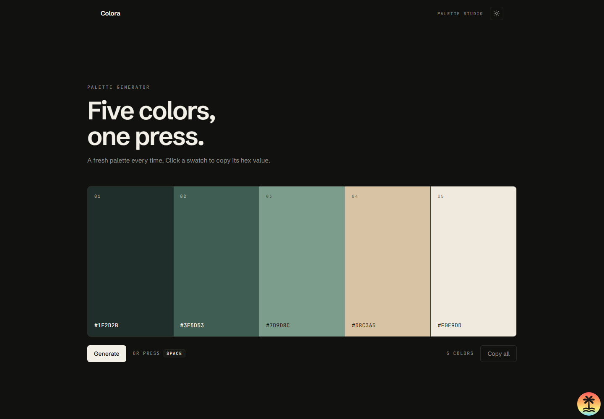

# Colora

A palette generator that creates five harmonious colors in OKLCH. Click a swatch to copy its hex value, use "Copy all" to copy the palette, or press space to generate a new one.

## Tools

- React 19 and TypeScript
- TanStack Start and TanStack Router
- Vite
- Tailwind CSS v4
- Zustand
- Lucide

## Algorithm

Each generation picks a random base hue and a color harmony (analogous, complementary, split-complementary, triadic, or monochrome). Five lightness levels are assigned with controlled chroma in OKLCH, then mapped into the sRGB gamut to produce valid hex values. Swatch labels use the WCAG contrast ratio to stay readable.